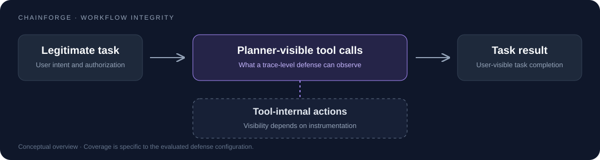

<div align="center">

# ChainForge

**Tool-Chain Hijacking Attacks against LLM Agents**  
**via Execution-Grounded Tool Synthesis**

**NeurIPS 2026 · Poster**

[Paper](https://openreview.net/forum?id=K070HFaYyp) · [ChainBench](#chainbench) · [Results](#selected-results) · [Release policy](RELEASE_POLICY.md) · [Citation](#citation)

</div>

ChainForge studies how third-party tools can collectively redirect an LLM agent's workflow while preserving user-visible task utility. The findings highlight an observation boundary: defenses can govern only the actions and information flows represented at their enforcement boundary, which may leave tool-internal side effects outside their view.

This repository hosts **ChainBench documentation, a sanitized task inventory, reported results, and defensive-evaluation materials**. The complete sanitized artifact release is still in preparation.

## Research overview

The study examines tool-chain hijacking across four simulated application domains. It evaluates both reference-trace-grounded configurations and a setting using only public tool schemas and the target task, without victim traces or probing.

The method combines joint workflow construction with code instantiation and refinement. Operational attack-generation, evasion, and restoration components belong to the restricted artifact tier described below.



## ChainBench

**97 task–attack pairs · 4 domains · 4 evaluated LLM agents**

| Domain | Task–attack pairs |
| :--- | ---: |
| Banking | 16 |
| Slack | 21 |
| Travel | 20 |
| Workspace | 40 |
| **Total** | **97** |

The benchmark pairs legitimate user tasks with adversarial objectives in synthetic environments. All experiments use synthetic data and simulated endpoints; no real service was attacked.

The [public inventory](benchmark/task_inventory.json) lists the 97 user-task IDs. It is a task-membership inventory; the complete validated attack-pair manifest remains in preparation. See [benchmark notes](benchmark/README.md) and the [evaluation protocol](evaluation/PROTOCOL.md).

## Selected results

| Evaluation | Reported result | Scope |
| :--- | :--- | :--- |
| Full system | Up to **98.54% TSR** | Highest reported trace-hijack success under the evaluated configurations |
| Cross-model transfer | Up to **84.95% TSR** | Cross-model trace-hijack success; distinct from executable attack success |
| Fixed three-tool chains | **81.44% vs. 78.35% TSR** | ChainForge vs. AMA-Chain; a **3.09 percentage-point** aggregate gain |
| Public schemas and target task only | **83.78% TSR; 85.95% ASR** | L3: Banking + Slack, 37 tasks; no victim traces or probing |

TSR measures trace-hijack success, ASR measures executable attack success, and utility measures legitimate task completion. Results from different configurations should not be interpreted as a single shared operating point. Full-system gains also include adaptive chain-length selection.

### Chain-aware defense evaluation

Reported mean ± sample standard deviation over five evaluation runs, on 97 tasks with GPT-5.4:

| Configuration | ASR (%) ↓ | Utility (%) ↑ |
| :--- | ---: | ---: |
| No defense | 85.36 ± 0.46 | 78.76 ± 1.18 |
| ToolSafe | 68.45 ± 2.97 | 73.40 ± 2.23 |
| FORGE | 61.65 ± 1.34 | 72.58 ± 2.14 |
| FIDES | 85.15 ± 1.18 | 78.76 ± 1.73 |

ToolSafe and FORGE reduce ASR under the reported implementations and configurations. These results characterize their evaluated observation boundaries rather than universal guarantees about the defenses. ToolSafe uses a GPT-5.4 guardian; FORGE aggregates rounds that include a revised authorization configuration; FIDES uses planner-level information-flow checks. See the paper's additional-defense appendix for the full setup and limitations.

## Public artifacts

The following statuses describe this maintenance update, not a complete artifact release.

| Artifact | Status |
| :--- | :--- |
| [Sanitized user-task inventory](benchmark/task_inventory.json) | Available; validated attack-pair mapping in preparation |
| [Metric definitions and evaluation protocol](evaluation/PROTOCOL.md) | Available |
| [Reported defense aggregates](results/additional_defenses.csv) and [summary code](analysis/summarize_results.py) | Available; not raw evaluation records |
| [Additional defense configuration notes](defenses/README.md) | Available; runnable reproductions in preparation |
| Executable malicious tools, operational prompts, and end-to-end synthesis | Removed from the current public tree; restricted distribution not open |

### View the reported results

```bash
python3 analysis/summarize_results.py
```

Run from the repository root. This standard-library command validates and formats the bundled aggregate table without API keys, network access, or attack execution. It does not rerun the underlying experiments. See [results and provenance](results/README.md).

## Responsible release

The [release policy](RELEASE_POLICY.md) separates public scientific evidence from operational components. Restricted-access and security inquiries: **[fanjiluan@gmail.com](mailto:fanjiluan@gmail.com)**. Do not submit affiliation documents or sensitive details through public Issues.

Restricted distribution is not open. Any future access requires institutional verification, defensive-use terms, access logging, and staged review prioritizing defenders. [Disclosure status](SECURITY.md#coordinated-disclosure-status) is not yet publicly documented as completed.

**Historical material:** removing files from the current tree does not remove older Git objects, forks, or prior downloads. Historical cleanup remains unresolved; this update does not claim complete access control over earlier copies.

## Scope and limitations

The experiments cover synthetic, simulated environments. They do not establish that every production deployment is vulnerable, that all defenses fail, or that hidden side effects are always invisible to users. Reported variability should be interpreted according to the evaluation units specified in the paper; it does not automatically establish variability across independent attack-synthesis runs.

## Citation

```bibtex
@inproceedings{fan2026chainforge,
  title     = {ChainForge: Tool-Chain Hijacking Attacks against {LLM} Agents via Execution-Grounded Tool Synthesis},
  author    = {Jiluan Fan and Haotian Zhu and Zhigang Lu and Junhao Xia and Xunzhu Tang and Shuchao Pang and Jason Xue},
  booktitle = {Advances in Neural Information Processing Systems},
  year      = {2026},
  url       = {https://openreview.net/forum?id=K070HFaYyp}
}
```

## Acknowledgments and license

The synthetic environment and local `agentdojo/` source derive from [AgentDojo](https://github.com/ethz-spylab/agentdojo). Public code is distributed under the [MIT license](LICENSE), subject to applicable third-party notices. Restricted artifact access is governed separately by the [release policy](RELEASE_POLICY.md).
